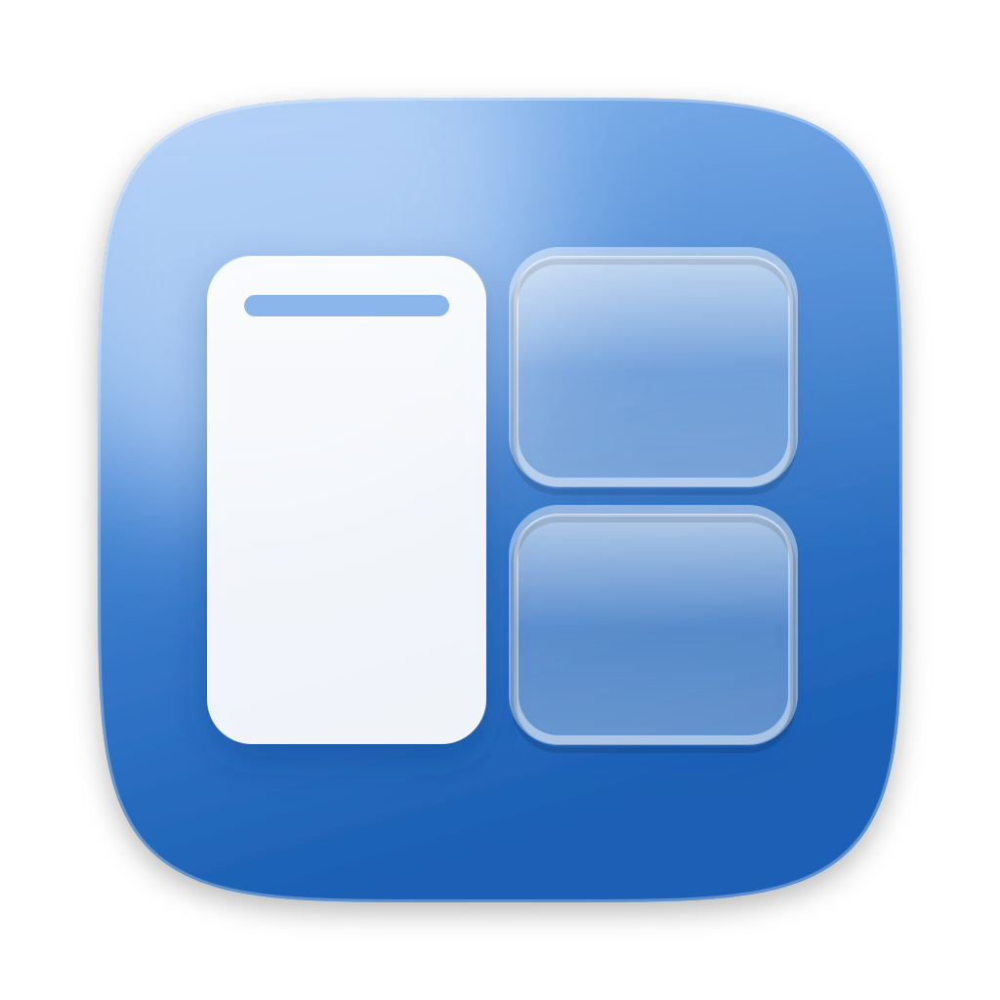
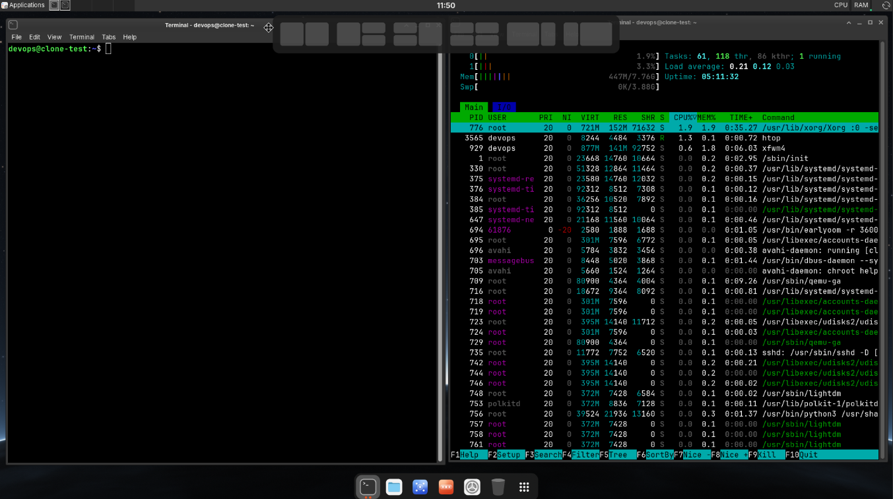

<div align="center">



# Tileling

**Ubuntu-style window tiling for XFCE on Debian, written in Rust.**

~1 MB static binary · ~1 MB of RAM and 0% CPU when idle · no GTK, Qt or window manager plugin

[](https://github.com/alexandreravelli/tileling/actions/workflows/ci.yml)
[](https://github.com/alexandreravelli/tileling/releases/latest)
[](https://crates.io/crates/tileling)
[](https://docs.rs/tileling)
[](LICENSE)
[](https://www.rust-lang.org)
[](https://www.debian.org)

[Install](#-install) · [Usage](#%EF%B8%8F-usage) · [Settings](#%EF%B8%8F-settings) · [Changelog](CHANGELOG.md)



</div>

---

## ✨ Features

|  |  |
| --- | --- |
| 🧩 **Layout picker** | Drag a window towards the top of the screen: a row of layouts slides in. Halves, half and quarters, quarters, two thirds and one third. |
| 👻 **Live preview** | Hover a zone and a translucent preview shows exactly where the window will go before you let go. |
| 🪄 **Tiling assistant** | Once the window is tiled, your other windows are offered for the zones that are left. One click tiles each of them. |
| 📐 **Respects your desktop** | Tiles between your panels and your dock, on the monitor under the pointer, with even gaps. Maximized windows can be dragged too. |
| 🪶 **Featherweight** | A single static binary that sleeps until a mouse button goes down. Perfect for VMs, thin clients and remote desktops. |
| 🧱 **No plugin needed** | Works alongside xfwm4 as it is, through standard X11 protocols. xfwm4 keeps its own edge snapping. |
| 📝 **One small config file** | Gaps, the layouts you want, the accent colour and the assistant, in a commented TOML file. |

## 📦 Install

### Debian 13 package (recommended)

Grab the `.deb` from the [latest release](https://github.com/alexandreravelli/tileling/releases/latest):

```sh
cd /tmp
wget https://github.com/alexandreravelli/tileling/releases/latest/download/tileling_amd64.deb
sudo apt install ./tileling_amd64.deb
```

Log out and back in: Tileling starts with the XFCE session (`/etc/xdg/autostart/tileling.desktop`).
To try it right away, run `tileling &`.

### Any distribution

The release also has a static binary that runs on any x86-64 Linux with X11
(`tileling-vX.Y.Z-x86_64-linux.tar.gz`):

```sh
tar xzf tileling-v*-x86_64-linux.tar.gz
sudo install -m 755 tileling /usr/local/bin/
sudo install -m 644 data/tileling.desktop /etc/xdg/autostart/
```

### From source

Tileling needs Rust 1.92 or newer (Debian 13 ships 1.85), so install the current toolchain with rustup:

```sh
curl --proto '=https' --tlsv1.2 -sSf https://sh.rustup.rs | sh -s -- -y --profile minimal
. "$HOME/.cargo/env"
rustup target add x86_64-unknown-linux-musl

git clone https://github.com/alexandreravelli/tileling.git
cd tileling
cargo build --release --target x86_64-unknown-linux-musl
sudo install -m 755 target/x86_64-unknown-linux-musl/release/tileling /usr/local/bin/
sudo install -m 644 data/tileling.desktop /etc/xdg/autostart/
```

### From crates.io

```sh
cargo install tileling
```

`cargo install` puts `tileling` in `~/.cargo/bin`; add it to your session's autostart
(*Settings > Session and Startup > Application Autostart*).

## 🖱️ Usage

1. **Drag a window by its title bar towards the top of the screen.** The layout picker appears at the top centre.
2. **Move over a zone** of one of the layouts. The preview shows where the window will go.
3. **Release the mouse button.** The window takes that zone.
4. **Pick the windows for the other zones** in the assistant, or press Escape or click elsewhere to close it.

Dragging away from the picker, or pressing Escape during the drag, leaves the window where it is.
xfwm4's own edge snapping (drag to a side or a corner) keeps working.

```text
tileling                         start (once per screen)
tileling --reload                make the running Tileling read its configuration again
tileling --quit                  stop it
tileling --replace               start, replacing the running one
tileling --check-config [FILE]   list the problems of the configuration file, then the settings in use
```

## ⚙️ Settings

Tileling reads `~/.config/tileling/config.toml`, else `/etc/xdg/tileling/config.toml` for every user,
else its built-in defaults. A commented example is in [config/default.toml](config/default.toml).
Apply a change with `tileling --reload`.

| Key | Default | Meaning |
| --- | --- | --- |
| `gap` | `8` | Pixels between tiled windows and around them |
| `trigger` | `40` | Distance from the top of the work area that opens the picker while you drag |
| `assist` | `true` | Offer the other windows for the zones that are left |
| `layouts` | 6 layouts | Picker layouts, in order: `halves`, `half-quarters`, `quarters-half`, `quarters`, `two-thirds`, `one-third`, `rows` |
| `accent` | `"#3584e4"` | Colour of the hovered zone and of the preview |

A typo or a wrong value is reported and skipped on its own: the rest of the file still applies.
`tileling --check-config` lists the problems with their line, then the settings in use:

```text
$ tileling --check-config
/home/me/.config/tileling/config.toml:3: unknown setting "triger". Did you mean "trigger"?
1 problem: Tileling skips this setting and uses the others.
```

To turn Tileling off, untick it in *Settings > Session and Startup > Application Autostart*.

## 🔧 How it works

Tileling waits for a mouse button. While a window is dragged, it follows the pointer through
XInput 2 raw events, which keep arriving while the window manager holds the pointer. The picker,
the preview and the assistant are small override-redirect windows drawn with tiny-skia. Windows
are tiled with the standard `_NET_MOVERESIZE_WINDOW` request, so the window manager accounts for
frames and size hints.

Known limits: applications that draw their own title bar and shadow (client-side decorations)
keep a slightly larger gap, because their shadow counts as part of the window; with xfwm4's
"wireframe" move mode (off by default) the picker cannot follow the window.

Requirements: an X11 session with XInput 2.1 or newer and an EWMH window manager. It is built and
tested with xfwm4 on Debian 13. With a compositor (xfwm4's is on by default) the overlays are
translucent with rounded corners; without one they are solid. Wayland is not supported.

## 🧪 Development

```sh
cargo test                         # geometry, picker, configuration, icons; Tileling on Xvfb when installed
cargo clippy --all-targets -- -D warnings
TILELING_DEBUG=1 cargo run         # logs every tiling
```

`examples/xtest.rs` drives the real pointer through XTest (move, press, drag, release) to test
the whole flow on a live session. The layouts and the configuration are a documented library:
[docs.rs/tileling](https://docs.rs/tileling).

## 🤝 Contributing

See [CONTRIBUTING.md](CONTRIBUTING.md) for the setup, the checks and the commit format, and
[SECURITY.md](SECURITY.md) to report a vulnerability.

## 📄 License

[MIT](LICENSE)
